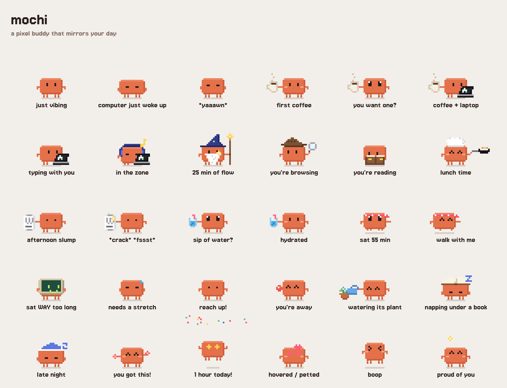

# Mochi

A pixel critter that lives on your Mac's screens: it wanders around, hops onto your windows, copies what you're doing, and nudges you to drink water, eat, and get up.



## Download

1. Grab **Mochi.zip** from the [latest release](https://github.com/Joseph-Rus/mochi/releases/latest) (macOS 13 or newer, Apple Silicon or Intel).
2. Unzip it and drag **Mochi.app** into your Applications folder.
3. Open it. Mochi isn't notarized by Apple, so the first time macOS will say it can't verify the app. Click **Done**, then go to **System Settings → Privacy & Security**, scroll down, and click **Open Anyway** next to Mochi. You only have to do this once.

   Or, from Terminal: `xattr -dr com.apple.quarantine /Applications/Mochi.app`

Mochi lives in your menu bar (no Dock icon). To quit, use its menu bar icon → Quit.

## What it does

| You... | Mochi... |
|---|---|
| start or wake the computer (after 45+ min away) | is tired, yawns, sips a coffee, then asks if you want one |
| type | types on its laptop |
| type steadily for 6 min / 25 min | puts on headphones / becomes a coding wizard |
| only use the mouse | puts on a detective hat and investigates |
| stop touching anything for a bit | reads a book |
| step away (45 s+) | juggles or waters its plant |
| stay away (8 min+) | naps under a book (nightcap after 11pm) |
| come back from a break | waves, counts it as a break |
| have been at it 45 min without water | holds out a glass of water |
| have sat 55 min | puts on sneakers and asks you to walk with it |
| have sat way too long | turns into a TV |
| work 11:30–1:45 | puts on a chef hat: have you eaten? |
| hit a 2–4pm slump | offers coffee, an energy drink, or a walk (water after 3pm) |
| usually get coffee around now | reminds you, based on the last week |
| are up past 11pm | wears a nightcap and tells you to go to bed |

### Getting around

| You... | Mochi... |
|---|---|
| leave it be | strolls along the bottom of the screen now and then; when you step away it explores, hopping between windows |
| switch to an app | sometimes hops onto the top of that window (if there's room above it) |
| move the window it's sitting on | rides along. Yank it hard and Mochi gets knocked off |
| close or cover that window | falls to whatever is below |
| pick it up and let go | drops with gravity; toss it and it flies, bouncing off the screen edges |
| work on your other display for a while | follows you over |
| stop your pointer just above its head | jumps for it |
| wiggle your pointer right next to it | gets dizzy |

It sticks to the bottom of the screen and to windows with room above them: a window that reaches the menu bar has no top for it to stand on. When it's perched up high, its speech bubble shows up underneath it instead.

### Your Mac

| You... | Mochi... |
|---|---|
| join a call (camera or mic on) | shows a mute sign and holds every reminder until you're done |
| watch something fullscreen, or in VLC | eats popcorn, quietly |
| play music in Spotify or Music | puts on headphones and vibes (headphones + laptop if you're typing) |
| pause typing in VS Code, Cursor, Xcode, a terminal... | holds up a rubber duck |
| run the battery under 20% | looks drained and tells you; does a happy zap when you plug in |
| switch to dark / light mode | puts on a nightcap / sunglasses |

It also cheers you on every 20–35 minutes, throws confetti on each hour you've worked, and gets heart eyes when you hover over it.

**Privacy:** Mochi reads macOS idle timers (seconds since the last key press or mouse move), the ID of the app in front (like `com.microsoft.VSCode`), where windows are on screen (positions only: no titles or contents), whether the camera, mic or speakers are in use (an on/off flag, never the audio or video), the battery level, and dark mode. It never sees what you type or what's in your windows. No permissions are needed and nothing leaves your Mac. Turn off **React to Apps & Calls** to stop it looking at apps, calls and music. State lives in `~/Library/Application Support/Mochi/state.json`.

## Using it

- **Drag** Mochi anywhere and let go (or throw it). **Click** to boop it. **Right-click** for the menu.
- The menu bar icon shows today's stats, lets you log water/coffee/walks, dress it up, send it to **Sit on My Window** or **Go Explore**, and has:
  - **Size**: Tiny, Small (the default), Medium, Large.
  - **Let Mochi Roam Around**: turn off to keep it exactly where you put it, no gravity.
  - **React to Apps & Calls**, **Quiet for an Hour**, **Open at Login**.

## Building

```sh
./build.sh           # → build/Mochi.app
./build.sh install   # → ~/Applications/Mochi.app, and launches it
./build.sh release   # → build/Mochi.zip, ready to attach to a GitHub release
```

Needs Xcode's Swift toolchain. `web/preview.html` shows every pose in a browser (they follow your cursor).

To test reminders quickly: `MOCHI_SPEED=60 ~/Applications/Mochi.app/Contents/MacOS/Mochi` makes the reminder timers 60× faster. `MOCHI_ROAM=2` makes it explore as if you'd stepped away (`1` for the occasional stroll) and logs every move to the terminal.

Re-render the PNGs in `renders/`: `Mochi.app/Contents/MacOS/Mochi --render <folder>` (run it from a copy outside `~/Documents`).

## Files

- `Sources/main.swift`: the Mac app: transparent always-on-top window, how Mochi gets around (screens and window tops become ledges; walking, hopping, falling, riding), sensors (idle, sleep/wake, app in front, camera/mic, battery), menus, saving.
- `web/pet.js`: the critter. Every pose and prop is drawn as pixel strings on a 46×34 canvas.
- `web/brain.js`: decides what Mochi does and says, and how much it may roam right now (it stays put while you type).
- `web/pet.css`: pixel speech bubble. Font: Jersey 15 (OFL, `web/fonts/OFL.txt`).
